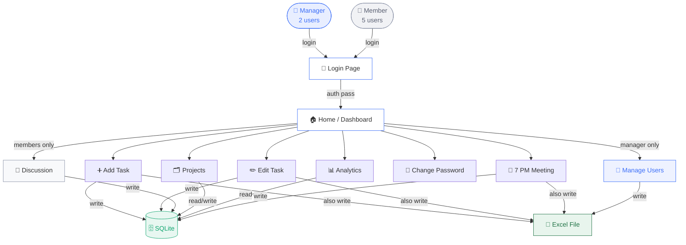
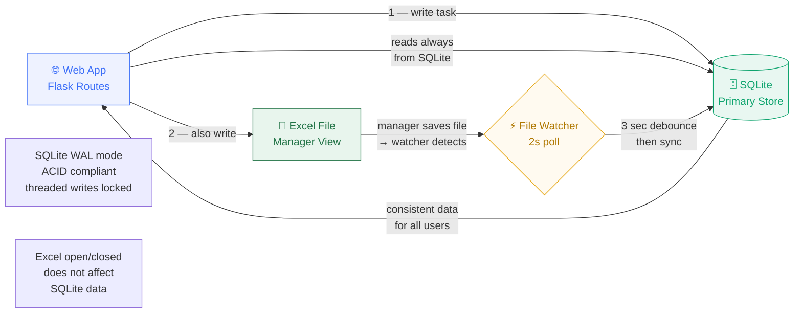
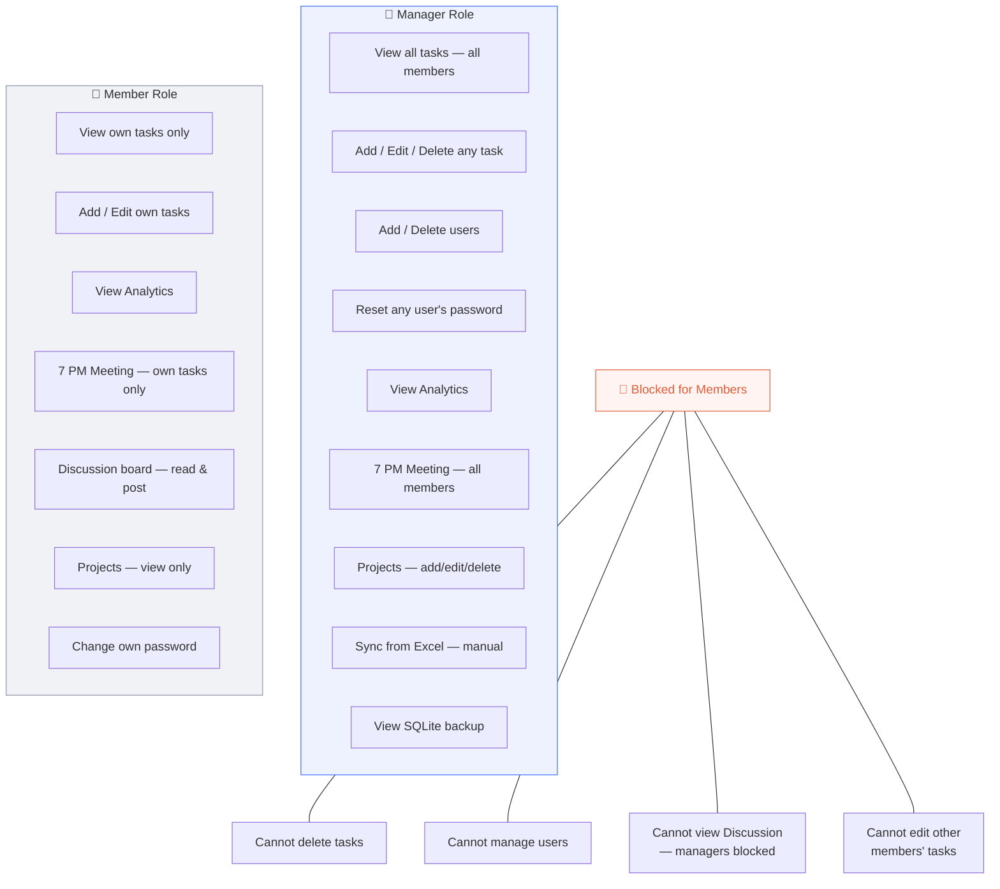

# Team Daily Planner — Project Blueprint

> **Stack:** Python · Flask · SQLite · Excel (openpyxl) · Chart.js  
> **Team:** 2 Managers + 5 Members · **Port:** 5001 · **Platform:** macOS

---

## Project Summary

- Flask web app for a team of 7 to plan and track daily tasks
- Role-based access (RBAC) — managers control everything; members manage only their own tasks
- **SQLite** is the primary store — web app always reads and writes here
- **Excel** is the manager's offline record — auto-syncs to SQLite within 5 sec of a save
- 7 PM Meeting page — plan tomorrow's tasks; members add their own, managers add for all
- Discussion board — members-only, not visible to managers
- Projects page — many-to-many (one member on multiple projects, one project with multiple members)
- Analytics page — live charts for task status, priority split, and member-wise progress
- All 7 users can work at the same time — threaded Flask + SQLite WAL mode (ACID compliant)
- Runs on a local Mac; managers access remotely via Tailscale (free) from any Wi-Fi

---

## Advantages

| # | Advantage |
|---|-----------|
| 1 | Zero cost — Flask, SQLite and Tailscale are all free |
| 2 | Data stays on your Mac — no cloud dependency or monthly fees |
| 3 | Excel file keeps working as the manager's familiar view |
| 4 | Auto-sync — Excel edits reflect on web app automatically in ~5 seconds |
| 5 | ACID compliant — no data corruption even under concurrent writes |
| 6 | Strict RBAC — members cannot access manager pages or discussion is hidden from managers |
| 7 | Simple to run — one terminal command starts everything |
| 8 | Concurrent — all 7 users can use it at the same time without conflicts |

---

## Disadvantages

| # | Disadvantage |
|---|--------------|
| 1 | Mac must stay ON — if it sleeps, the app goes down for everyone |
| 2 | Team must be on the same Wi-Fi (or Tailscale for remote access) |
| 3 | No mobile app — browser only, no native iOS/Android app |
| 4 | No real-time push — members must refresh the page to see new tasks |
| 5 | Passwords stored in plain text — no hashing implemented yet |
| 6 | Single point of failure — no backup server if Mac crashes |
| 7 | No email or push notifications for task reminders |
| 8 | Excel sync is one-way until the manager saves the file manually |

---

## Workflow Diagram

### 1. User Access Flow



---

### 2. Data Storage Flow



---

### 3. RBAC Permission Map



---

## File Structure

```
Task_management/
│
├── app.py                  # Entry point — Flask app, dashboard, analytics, file watcher
├── routes_tasks.py         # Add / edit / delete task + 7 PM meeting routes
├── routes_admin.py         # Users, projects, discussion, change password, backup
├── auth.py                 # Login, logout, RBAC decorators
├── excel_utils.py          # All Excel read/write (openpyxl)
├── db_backup.py            # SQLite CRUD — primary store for web app
├── db_projects.py          # Projects + project_members CRUD
├── config.py               # Priority / status / role options
│
├── templates/
│   ├── base.html           # Sidebar layout, nav, user card
│   ├── login.html          # Standalone login page
│   ├── dashboard.html      # Home / task list
│   ├── analytics.html      # Chart.js charts
│   ├── meeting.html        # 7 PM meeting page
│   ├── discussion.html     # Members-only discussion
│   ├── projects.html       # Projects cards
│   ├── users.html          # Manage users (manager only)
│   ├── add_task.html       # Add task form
│   ├── edit_task.html      # Edit task form
│   ├── change_password.html# Change password form
│   └── backup.html         # SQLite backup viewer
│
├── static/
│   └── style.css           # All CSS — tokens, sidebar, cards, charts, responsive
│
├── Team Daily Planner.xlsx # Excel file — manager's offline record
├── team_planner.db         # SQLite database — primary store
├── PROJECT_BLUEPRINT.md    # This file
└── project_summary.pdf     # PDF summary document
```

---

## Database Tables (SQLite)

| Table | Purpose |
|-------|---------|
| `tasks` | All tasks — excel_row, date, member, task, priority, status |
| `users` | Login credentials and roles |
| `discussion` | Members-only discussion notes |
| `activity_log` | Every login, task add/edit/delete action |
| `projects` | Project names, description, status |
| `project_members` | Many-to-many: project ↔ team member |
| `sync_meta` | Last Excel sync time and mtime |

---

## How to Run

```bash
# 1. Navigate to project folder
cd /Users/dhrumikhatri/Desktop/Task_management

# 2. Activate virtual environment
source .venv/bin/activate

# 3. Start the app
python app.py

# 4. Open in browser
# Local:   http://127.0.0.1:5001
# Team:    http://<your-mac-ip>:5001
# Remote:  http://<tailscale-ip>:5001
```

---

## Default Login Credentials

| Username | Password | Role |
|----------|----------|------|
| manager1 | manager1pass | Manager |
| manager2 | manager2pass | Manager |
| member1 | member1pass | Member |
| member2 | member2pass | Member |
| member3 | member3pass | Member |
| member4 | member4pass | Member |
| member5 | member5pass | Member |

> Change passwords after first login via the 🔑 icon in the sidebar.

---

*Team Daily Planner · Internal use only*
